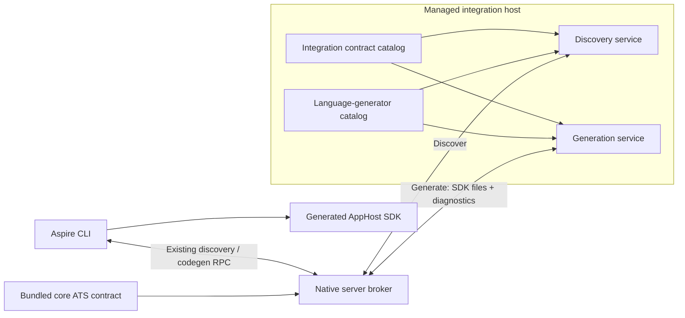

# Aspire App Model v2: Concepts, Design, and Authoring Guidance

> **Status:** AppHost Server v2 implementation behind the default-off project feature `features.appHostServerV2`; not a replacement for managed Hosting.
> **Audience:** Hosting integration authors and contributors exploring a language-neutral, NativeAOT-friendly application model.
> **Baseline:** [Aspire Resource Model](appmodel.md).
> **Related:** [Polyglot integrations](polyglot-integrations.md#single-runtime-representation).

## Overview

App Model v2 preserves Aspire's familiar authoring model: declare resources,
configure them with fluent APIs, connect them through references, and let the
runtime coordinate execution. The difference is where the model lives and how
integrations participate.

The application model is owned by a small AppHost Server v2 core. Integrations use
language-neutral contracts through the Aspire Type System (ATS), rather than
depending on live CLR objects inside the AppHost server. C# and TypeScript
projections provide ordinary typed APIs over the same model.

The guiding principles are:

- **Inert composition:** Declaring a resource does not start it or contact a service.
- **Authoritative model:** Identity, configuration, relationships and execution belong to the server.
- **Portable contracts:** Integration behavior must not depend on the core being implemented in C#.
- **Explicit ownership:** Resources, providers and operations have defined scopes and lifetimes.
- **Small core:** Service-specific implementation and dependencies stay in integrations.

### Reading the Code Samples

This guide distinguishes three kinds of code:

| Label | Meaning |
| --- | --- |
| **Current sample facade** | The C# or TypeScript authoring helpers under `playground/NativeIntegrations`, not the managed `Aspire.Hosting` implementation. |
| **Current core projection** | Existing generated ATS methods in `Aspire.Hosting.Native.Client` and the corresponding TypeScript SDK. |
| **Design sketch** | A proposed authoring contract, not an API available from the current product bundle. |

The product opt-in currently supports TypeScript/Node.js. C# examples explain
integration implementation and the generated core projection; they do not
make C# guest AppHosts supported by that flag.

The [Talking Clock walkthrough](#custom-resources-talking-clock) shows
declaration, fluent configuration, execution delegation, a controller loop,
observations, and shutdown using current core primitives. Its integration code
is an example to author, not a shipped package. Proposed parent relationships,
automatic controller activation, and richer presentation are identified
separately rather than hidden behind invented SDK methods.

### Authoring Examples

- [Declare an external API and retain a secret reference](#declaring-a-resource-through-ats).
- [Compose a service from generic workloads](#composing-an-integration-from-generic-workloads).
- [Author directly through generated RPC handles](#direct-rpc-authoring).
- [Design typed annotation data](#a-typed-annotation-contract).
- [Build a deferred connection expression](#constructing-a-connection-expression).
- [Register bounded lifecycle behavior](#a-bounded-provider-callback).
- [Report state and complete commands](#reporting-state-and-completing-commands).
- [Build Talking Clock from declarations through retirement](#custom-resources-talking-clock).
- [Stage and commit a model revision](#model-revisions-and-guest-reload).

## Quick Start

**Current sample facade.** The Redis examples use familiar fluent APIs:

```csharp
using Aspire.Hosting.Native.Authoring;
using NativeIntegrations.Redis;
using NativeIntegrations.Redis.AppHost;

var builder = DistributedApplication.CreateBuilder(args);
var cache = builder.AddRedis("cache").WithDataVolume();

builder.AddExecutable("consumer", executablePath, workingDirectory)
    .WithReference(cache)
    .WaitFor(cache);

await builder.Build().RunAsync();
```

The equivalent TypeScript authoring shape is:

```typescript
const builder = await createBuilder();
const cache = await builder.addRedis('cache').withDataVolume();

await builder.addExecutable('consumer', executablePath, workingDirectory)
    .withReference(cache)
    .waitFor(cache);

await builder.build().run();
```

`WithReference` supplies connection information to the consumer. `WaitFor`
expresses an explicit readiness dependency. These are different operations,
although resolving a value can itself require another resource to be ready.

The [native integration examples](../../playground/NativeIntegrations/README.md)
contain the current C# and TypeScript implementations. The C# builder records
commands synchronously; generated core projection calls are asynchronous.
Examples below label which surface they use.

The C# builder exposes `IConfiguration`. Environment variables are loaded
first, followed by caller-owned `NativeBuilderOptions.Configuration`, then
ordinary `--name=value` application arguments. The framework reads its native
endpoint and authentication token from the same configuration.

### Direct RPC Authoring

**Current core projection.** `createRpcBuilder` provides an additive run-mode
authoring surface whose calls immediately update the existing server-owned
composition. Unlike the sample recorder, it does not construct a second
client-side declaration graph. Its TypeScript interfaces, fluent promises,
value unions and callbacks come from the existing ATS generator.

```typescript
const { client, server } = await connectNativeAppHost(connectionOptions);
try {
    const builder = await server.createRpcBuilder();
    const cache = await builder.addContainer('cache', 'redis')
        .withImageTag('8-alpine')
        .withArgs(['--save', ''])
        .withEndpoint({ name: 'tcp', targetPort: 6379, scheme: 'redis' })
        .withSerializedAnnotation('example.cache/v1', '{"version":1}');

    const endpoint = await cache.getEndpoint('tcp');
    await cache.withConnectionString(endpoint.property('hostAndPort'));
    await builder.addExecutable('consumer', executablePath, workingDirectory)
        .withReference(cache)
        .withEnvironment('CACHE_URL', endpoint)
        .withEnvironmentCallback(async environment => {
            await environment.set('CACHE_HOST', endpoint.property('host'));
        })
        .withArgsCallback(async args => {
            await args.add('--cache');
            await args.add(endpoint.property('hostAndPort'));
        });

    const execution = await builder.build().startApplication();
    await execution.waitApplicationReady(15_000);
    await builder.retire();
} finally {
    await client.flushPendingPromises();
    client.disconnect();
}
```

The RPC/ATS IDs are independent of today's hosting IDs. The compatibility goal
is familiar authoring concepts, not wire compatibility or complete source
compatibility. This projection currently uses one resource-builder handle
type, `RpcResource`, for both container and executable declarations.

Environment inputs and argument editor inputs accept literal strings,
existing `DeclaredValue` handles, symbolic endpoints, and resources with a
declared connection string. `withReference` currently handles connection-string
producers, not the full managed service-discovery overload set. Endpoint
properties are created through `property('host' | 'port' | 'hostAndPort' | 'url')`.
Annotations retain their JSON payload in the existing resource configuration;
there is no second annotation store or CLR annotation activation.

These callbacks are **immediate composition edits**, not managed lifecycle
callbacks. The server calls the guest over authenticated bidirectional RPC,
and the callback uses a resource-scoped editor handle for nested RPC calls.
The editor expires when the callback completes, fails, times out, or its
generation retires. Building while a callback is active is rejected. Callback
edits are not transactional: successful edits remain if a later edit fails.

These composition callbacks do not themselves implement a publishing pipeline,
network-address resolution, richer callback service contexts, long-running
controllers, or kernel dependencies.
The sample recorder and the supported managed CLI path remain separate and
unchanged.

## Architecture

There are three main participants:

| Participant | Responsibility |
| --- | --- |
| AppHost | Compose the graph, select integrations and request execution |
| Native hosting core | Own declarations, relationships, values, scheduling and workload lifetime |
| Integration host | Implement integration APIs and service-specific runtime behavior |

ATS describes the contracts between these participants. Generated projections
carry typed values, resource references and callbacks across the boundary.
Callers use resource APIs, not protocol messages or transport-specific details.

An integration host can use service clients, local services and background
controllers. Those dependencies do not become dependencies of the native core.
The execution backend starts generic containers and executables; the core does
not need a Redis implementation to run a Redis resource.

### Code Generation and JSON Boundaries

The TypeScript SDK uses the existing ATS TypeScript generator, not a separate
SDK-generation system. `Aspire.Hosting.Native.CodeGeneration` is a nonshipping
build tool: the server's MSBuild target scans ATS declarations offline, emits
static C# dispatch and embeds its contract and core SDK. Roslyn and reflection
stay in that build tool, not in the execution server.

**Current implementation.** For provider-backed product AppHosts, the CLI invokes
`aspire-managed apphost-codegen-v2` during preparation. This combines the bundled
core contract and provider metadata with the same ATS TypeScript generator.
The execution server exposes these prepared SDK files through its ordinary
code-generation RPC.

Tooling reads files into typed inputs before merging contracts or generating
code. Portable metadata is translated to ATS by a shared tooling reader;
generators do not inspect provider JSON. Contract and output-name validation
finish before files are written. At runtime, metadata parsing, native contract
validation and registration/authority resolution are separate stages.

#### Planned Integration-Host Tooling

The managed integration host will discover both integration contracts and
language-generator plugins. The native server will delegate discovery and
generation through the existing CLI RPC contract, keeping generators, assembly
scanning and Roslyn outside the native execution server.



Each generator advertises its language, version and supported contract features.
Generation selects a compatible generator for the combined core and selected
integration contracts. Providers supply portable metadata; they do not each
need generators for every consumer language. Runtime registration must agree
with the contract used to generate the SDK.

Discovery and generation do not execute the AppHost or start resources.
Published packages can ship contracts; local integrations can refresh theirs
during preparation.

#### Planned Process Lifetimes

Processes are scoped to a command or AppHost session, not machine-wide daemons.

| Component | Lifetime |
| --- | --- |
| CLI | Owns the command/session and its child-process scope. |
| Native server | Lives across composition revisions for the application session. |
| Integration host | Starts lazily for discovery/generation; stays alive when needed for integration APIs, callbacks or controllers. A tooling-only host can exit after generation. |
| Language generator | A plugin invoked inside the host, not a separate process per language or request. |
| Guest AppHost | Runs composition; can restart while the server retains the workspace. |

Shutdown retires the application while integrations are still available, drains
callbacks/controllers and cleans up owned workloads, then stops hosts and the
native server. The CLI enforces bounded shutdown and orphan cleanup. The current
spike still uses a short-lived codegen command and separately activated providers.

#### JSON Boundaries

The core model has no JSON dependency. At the server boundary, `JsonElement`
reads and validates immutable wire data, including rejecting duplicate keys.
`JsonObject`/`JsonArray` are used where replies or delegated handle arguments
must be constructed or rewritten. These representations serve different
purposes; mutable JSON does not become authoritative model state.

`SymbolicValue` is the core's immutable representation of a reference
expression. It retains endpoint and parameter dependencies, secret
classification and generation ownership until the runtime can resolve a value.
The familiar authoring `ReferenceExpression` is a client facade over this
server-owned expression, not a second independently authoritative model.

### Core Baseline Versus In-Process Conveniences

The existing hosting model mixes portable semantics with useful .NET
implementation techniques. V2 preserves the semantics without requiring those
techniques at the server boundary.

| Existing pattern | V2 direction |
| --- | --- |
| Resource classes and `IResourceBuilder<T>` | Typed facades over server-owned resource identities |
| Standard resource interfaces | Language-neutral capability contracts |
| Arbitrary annotation objects | Structured extension data with declared semantics |
| Captured value-provider delegates | Structured expressions and explicit provider contracts |
| Application event subscriptions | Resource-scoped lifecycle registrations |
| In-process custom resource loops | Integration-owned controllers |
| Manifest writer callbacks | Typed model views and structured publishing contributions |

A projection can still use extension methods, classes or interfaces locally.
They are authoring conveniences, not the authoritative representation of the
graph.

## Resource Basics

A resource is a named entity in the application graph. Its declaration describes
configuration, capabilities, outputs and relationships. Runtime state is kept
separately from that declaration.

Resource identity is more than its display name. A replacement resource with
the same name must not inherit the previous resource's execution authority or
pending operations.

Resources are inert during composition. Constructors and `AddX` methods must
not start workloads, allocate endpoints, resolve credentials or provision
external services.

### Resource Type and Execution Kind

An integration's resource type describes what the resource represents. Its
execution kind describes how it operates.

| Resource | Execution kind |
| --- | --- |
| Redis or PostgreSQL server | Container |
| Application or tool | Executable |
| PostgreSQL database | Logical child with initialization behavior |
| Dev Tunnel | Integration-owned controller |
| Parameter or connection value | Model data without independent execution |

A Redis resource can build on generic container capabilities while adding
Redis-specific configuration and connection properties. It should not require
a Redis-specific type inside the core.

General integration-defined resource schemas remain part of the design
direction. A caller-provided type name alone must never grant additional
capabilities.

### Declaring a Resource Through ATS

**Current core projection.** An integration does not need to install a resource
class into the server. It can declare a resource and keep a typed local facade:

```csharp
using Aspire.Hosting;
using Aspire.Hosting.Native.Client;

public static class ExternalApiExtensions
{
    [AspireExport("addExternalApi")]
    public static async Task<ExternalApiResource> AddExternalApi(
        Composition composition, string name, string baseUrl)
    {
        var uri = new Uri(baseUrl, UriKind.Absolute);
        if (uri.Scheme is not ("http" or "https") ||
            !string.IsNullOrEmpty(uri.UserInfo))
        {
            throw new ArgumentException(
                "An external API requires an HTTP(S) URL without credentials.",
                nameof(baseUrl));
        }

        var declaration = await composition.AddResourceAsync(
            name, "example/external-api");
        await declaration.SetResourceConfigurationAsync(new ResourceConfiguration
        {
            Properties =
            [
                new() { Name = "baseUrl", Value = uri.AbsoluteUri }
            ]
        });

        return new ExternalApiResource(declaration);
    }
}

[AspireExport]
public sealed class ExternalApiResource(DeclaredResource declaration)
    : NativeIntegrationResource(declaration)
{
    [AspireExport("withApiKey")]
    public async Task<ExternalApiResource> WithApiKey(DeclaredValue apiKey)
    {
        await Declaration.SetSymbolicConfigurationAsync("apiKey", apiKey);

        return this;
    }
}
```

This is the pattern used by the
[C# external API integration](../../playground/NativeIntegrations/CSharp/ExternalApi/ExternalApiExtensions.cs).
`DeclaredResource` and `DeclaredValue` are generated capability handles.
`ExternalApiResource` is provider-local authoring state anchored to a native
declaration, not an object the server reflects over to discover model behavior.
The URI is ordinary configuration; the API key remains a server-owned value.

`SetResourceConfigurationAsync` replaces the resource's complete literal
configuration. An integration must preserve other fields it owns when changing
one field. Symbolic values use the separate field-oriented
`SetSymbolicConfigurationAsync` operation.

## Standard Capabilities and Polymorphism

Capabilities describe what a resource supports independently of its concrete
integration type.

| Capability | Purpose |
| --- | --- |
| Environment | Configure literal or deferred environment values |
| Arguments | Configure executable or container arguments |
| Endpoints | Declare named ports and reference their allocated values |
| Connection properties | Expose connection information for consumers |
| Readiness dependencies | Coordinate startup with other resources |
| Lifecycle ownership | Tie a resource's execution to an owner |
| Observations | Read state, health, endpoints and configuration status |

Generic tooling should work against these capabilities rather than enumerate
every integration's resource type. A publisher should be able to inspect a
container or connection expression without loading the integration's CLR class.

Generated clients provide compile-time guidance. The server independently
checks applicability and authority; possessing a resource reference does not
automatically permit changing its runtime state.

## Add and With Authoring Patterns

### Adding Resources

`AddX` creates a resource, establishes sensible defaults and contributes the
configuration or behavior needed by that integration.

For Redis, this includes a container image, a TCP endpoint, a symbolic password,
connection expressions and authenticated readiness checking. The integration
owns those Redis-specific choices; the core owns the resulting graph and
generic workload execution.

An `AddX` method should return an appropriately typed resource builder. The
resource remains configurable until composition is sealed.

### Configuring Resources

`WithX` modifies a declaration without changing its identity:

```csharp
var cache = builder.AddRedis("cache").WithDataVolume();
var consumer = builder.AddExecutable("consumer", executablePath, workingDirectory)
    .WithReference(cache)
    .WaitFor(cache);
```

Configuration methods should distinguish settings, value references,
relationships and runtime behavior. A method that creates a child resource
should make that distinction clear.

### Integration Implementation

An integration has two kinds of work:

| Kind | Examples |
| --- | --- |
| Composition | Declare a workload, add endpoints, configure arguments, expose connection properties |
| Runtime behavior | Initialize a database, perform a health probe, monitor a tunnel, handle a command |

Simple integrations can be composed entirely from generic workload primitives.
Others register behavior implemented in their integration host. Exported
methods and their generated projections form the shared API; consumers do not
need to know how providers are connected.

### Composing an Integration From Generic Workloads

**Current sample facade.** A simple service can be a thin wrapper over generic
container primitives. For example, a local HTTP service needs no custom
execution backend:

```csharp
using Aspire.Hosting.Native.Authoring;

public static class WebServerExtensions
{
    public static IResourceBuilder<ContainerResource> AddWebServer(
        this DistributedApplicationBuilder builder, string name)
    {
        return builder.AddContainer(name, "nginx:alpine")
            .WithEndpoint("http", 80, "http");
    }
}
```

**Current core projection.** The equivalent declaration can configure a named
content volume as read-only:

```csharp
var server = await composition.AddContainerAsync("web", "nginx:alpine");
await server.WithEndpointAsync(new WorkloadEndpointDeclaration
{
    Name = "http",
    Protocol = "TCP",
    UriScheme = "http",
    TargetPort = 80,
    HostPort = 0,
    EnvironmentVariable = ""
});
await server.WithVolumeAsync(
    contentVolumeName, "/usr/share/nginx/html", true);
```

Use an existing generic capability when it expresses the behavior. Add a
facade helper only when it records the same real declaration operation. The
named volume remains external storage; retiring the container does not delete
it. Neither example launches the service while composing the graph.

## Annotations and Extension Data

Annotations remain an important extensibility concept, but arbitrary live
objects cannot be the portable representation.

The intended contract is structured, typed data with explicit semantics:

- Singleton settings replace a previous contribution.
- Repeatable contributions preserve their identity and ordering.
- Relationship and expression fields retain their references.
- Runtime behavior is registered explicitly, not serialized as a delegate.

For example, Redis persistence settings could be represented as typed
integration metadata. Another integration or publisher could inspect that data
without loading a Redis implementation.

Portable annotation schemas are not implemented as a general native API today.
Integration-local objects are allowed, but are not shared model annotations.

### A Typed Annotation Contract

**Design sketch.** An annotation should have a declared schema and mutation
semantics, not be an arbitrary dictionary of live integration objects. For
example, a persistence schema could use this DTO:

```csharp
using Aspire.Hosting;

[AspireDto]
public sealed class RedisPersistenceSettings
{
    public required bool AppendOnly { get; init; }
    public required string DataDirectory { get; init; }
}
```

The intended authoring operation is conceptually:

```typescript
// Proposed schema-aware API, not an existing generated SDK method.
await cache.setAnnotation('example.redis/persistence', {
    appendOnly: true,
    dataDirectory: '/data'
});
```

The schema registration would identify this as a singleton annotation:
another write replaces its value without changing the resource identity.
An integration or publisher reads the same typed data. The annotation does
not contain a Redis client, a callback, an allocated port, or a resolved secret.
The server must validate the schema and write authority before accepting it.

The existing
[Redis persistence helper](../../playground/NativeIntegrations/CSharp/Redis/RedisContainerResource.cs)
instead contributes a real named volume through `WithVolume`; it does not
depend on this proposed annotation API:

```csharp
public static IResourceBuilder<RedisContainerResource> WithDataVolume(
    this IResourceBuilder<RedisContainerResource> cache, string volumeName)
{
    return cache.WithVolume(volumeName, "/data");
}
```

## Values and References

A value can be a literal, parameter, endpoint property or expression composed
from other values.

Connection information should remain structured rather than be resolved into
a string during composition:

```text
Redis connection
  = scheme
  + encoded password parameter
  + endpoint host
  + endpoint port
```

This preserves references and sensitivity until the value is needed. Runtime
resolution supplies the values appropriate to execution; a future publisher
must translate the same expression for its deployment target.

Sensitivity propagates through expressions. Formatting a secret into a URI
does not make the result safe to include in model inspection or logs.

### Constructing a Connection Expression

**Current core projection.** Given an authenticated Redis declaration named
`cache`, a composition-owned `password` value, and an executable declaration
named `consumer`, this builds a deferred URI without fetching the password or
allocated address:

```csharp
var prefix = await composition.CreateLiteralValueAsync("redis://:");
var escapedPassword = await password.EncodeUriValueAsync();
var separator = await composition.CreateLiteralValueAsync("@");
var address = await composition.CreateEndpointValueAsync(
    cache, "tcp", "hostAndPort");

var connection = await prefix.ConcatValueAsync(escapedPassword);
connection = await connection.ConcatValueAsync(separator);
connection = await connection.ConcatValueAsync(address);

await consumer.WithReferenceAsync("ConnectionStrings__cache", connection);
await consumer.WaitForAsync(cache);
```

`ConcatValueAsync` and `EncodeUriValueAsync` create new server-owned expressions.
The password stays secret and the endpoint reference retains its dependency.
The consumer is a host executable: general container-consumer network
resolution is not implemented. Supplying this expression to a container must
not be presented as supported cross-network resolution.

The integration supplies a connection format its consumers actually understand.
The current Redis sample uses the StackExchange.Redis configuration format;
the URI above demonstrates expression composition, not a replacement for that
sample's connection contract.

The fluent sample facade expresses the same idea without projection plumbing:

```csharp
var endpoint = cache.GetEndpoint("tcp");
consumer.WithEnvironment("CACHE_ADDRESS", endpoint.HostAndPort)
    .WithReference(cache)
    .WaitFor(cache);
```

This fragment uses a fluent `cache` builder, not the `DeclaredResource` variable
in the previous fragment. Resolving a reference is runtime work; neither form
should call a service client during composition.

### Endpoints

An endpoint declaration describes its name, protocol, scheme and requested
ports. An allocation supplies the actual runtime address.

References target the declaration, not a cached local port. Replacement or
restart can change the allocation without changing the authored expression.
A workload can expose multiple independently named endpoints.

Resolution must ultimately account for the consumer's network context. A
host-facing address is not automatically the correct address for another
container. General consumer-network resolution remains an open requirement.

## Relationships and Resource Hierarchy

Different relationships express different obligations:

| Relationship | Meaning |
| --- | --- |
| Visual grouping | Nest resources in presentation without controlling execution |
| Lifecycle ownership | Tie a child's lifetime to its owner |
| Readiness dependency | Wait for another resource to satisfy a condition |
| Value reference | Consume a parameter, endpoint or output |

These relationships are explicit, not inferred from names. A visual parent is
not automatically a lifetime owner, and sharing a connection is not equivalent
to requesting a readiness wait.

**The native runtime distinguishes allocation from readiness.** Symbolic
endpoint references wait for address allocation, not for the producer to start
or become healthy. `WaitFor` separately declares a readiness prerequisite.
The resource reference graph may contain cycles; the execution prerequisite
graph must not.

For example, these generated RPC calls configure mutually referencing HTTP
executables without a readiness cycle:

```typescript
const builder = await server.createRpcBuilder();
const alpha = await builder.addExecutable('alpha', process.execPath, process.cwd())
    .withArgs(['alpha.mjs'])
    .withEndpoint({ name: 'http', scheme: 'http', env: 'PORT' });
const beta = await builder.addExecutable('beta', process.execPath, process.cwd())
    .withArgs(['beta.mjs'])
    .withEndpoint({ name: 'http', scheme: 'http', env: 'PORT' });

const alphaEndpoint = await alpha.getEndpoint('http');
const betaEndpoint = await beta.getEndpoint('http');
await alpha.withEnvironment('SELF_URL', alphaEndpoint)
    .withEnvironment('PEER_URL', betaEndpoint);
await beta.withEnvironment('SELF_URL', betaEndpoint)
    .withEnvironment('PEER_URL', alphaEndpoint);

const application = await builder.build();
await (await application.startApplication()).waitApplicationReady(30_000);
```

Each worker binds the DCP-supplied `PORT`. `SELF_URL` and `PEER_URL` are
symbolic expressions resolved at launch, not strings obtained by starting the
workers during composition. Neither worker requests `waitFor` on the other.

The executor can prepare an owned allocation before launching a workload:

```text
declare -> allocate -> configure -> start -> ready
```

If A needs B's URL and B needs A's URL, each configuration waits for the other's
allocation. Neither start waits for the other's readiness. An expression may
also reference its own allocated endpoint. DCP reserves proxy addresses before
submitting the executable or container; allocated addresses are not assertions
that the workload is running or accepting connections.

The combined operation graph is validated before workload side effects.
An explicit mutual readiness wait fails with a named milestone diagnostic,
for example:

```text
Execution prerequisite cycle: beta.Start -> alpha.Ready -> alpha.Start -> beta.Ready -> beta.Start
```

Preparation owns cleanup even when configuration fails or startup is canceled.
Workspace revisions invalidate consumers through both value references and
readiness edges, stop the affected workloads, clear their old allocations, and
prepare replacements before resolving new launch values. Shutdown ordering
follows explicit readiness prerequisites, not cyclic value relationships.

The dedicated native validation lane runs `NativeMilestoneSmoke.mts` against
the published NativeAOT server and real DCP. Two HTTP executables exchange
their actual allocated URLs, including self references and symbolic arguments;
a workspace revision proves rebinding; a Redis container proves prepared proxy
routing; and a mutual `WaitFor` is rejected rather than hanging. This does not
yet implement generic provider-produced output milestones or container-to-container
address translation.

**Current core projection.** A database can be declared independently and
explicitly wait for its server:

```csharp
var database = await composition.AddResourceAsync(
    "app-db", "example.postgres/database");
await database.SetResourceConfigurationAsync(new ResourceConfiguration
{
    Properties =
    [
        new() { Name = "databaseName", Value = "app_db" }
    ]
});
await database.WaitForAsync(postgres);
```

This declares a readiness edge. It does not create a database, confer execution
authority, or establish visual/lifecycle parenthood. A provider must perform
idempotent database creation at the appropriate runtime phase, using an
explicit initialization registration.

**Design sketch.** The relationship vocabulary needs to preserve these
distinctions in generated APIs:

```typescript
// Proposed relationship APIs, not existing generated SDK methods.
await database.withVisualParent(postgres);
await database.withLifetimeOwner(postgres);
await database.waitFor(postgres); // Existing readiness concept.
```

Talking Clock below uses explicit execution scopes for its two hands. It does
not pretend that naming them `clock-tick` and `clock-tock` implements either
of the proposed parent relationships.

## Lifecycle and Health

The core coordinates execution. Integrations supply service-specific behavior
through scoped registrations.

| Behavior | Example |
| --- | --- |
| Preparation | Produce files or configuration required for execution |
| Initialization | Create a PostgreSQL database after the server is ready |
| Pre-start work | Configure a tunnel using allocated endpoint information |
| Health checking | Authenticate to Redis and issue a protocol probe |
| Controller | Monitor an external service and report observations |
| Disposal | Release integration-owned state and await background work |

Initialization is bounded work that completes. A controller has an ongoing
lifetime that must be explicitly owned and stopped. Neither belongs in a
resource constructor.

Running and ready are separate concepts. A container process can be running
while its service is unavailable. Dependents must observe the declared
readiness condition, not merely an open port.

Provider failures and disconnects must be visible. The core must not retain
healthy state indefinitely after the integration responsible for it disappears.

### A Bounded Provider Callback

**Current core projection.** A provider can register an offline-discovered
lifecycle handler on an integration-owned resource:

```csharp
using Aspire.Hosting;
using Aspire.Hosting.Native.Client;

[AspireExport]
public sealed class CacheResource(DeclaredResource declaration)
    : NativeIntegrationResource(declaration)
{
    [AspireExport("cacheReady"), NativeResourceLifecycle("ready")]
    public Task Ready(
        ResourceLifecycleScope scope, CancellationToken cancellationToken)
    {
        return scope.WriteLifecycleLogAsync(
            "stdout", "Cache is ready.", cancellationToken);
    }
}
```

The handler runs with phase-scoped authority. It does not receive a service
provider, a raw graph, or credentials to inspect. Where a service-specific
operation needs resolved secret inputs, `RunLifecycleExecutableAsync` can run
a bounded tool using captured symbolic bindings; those resolved inputs remain
native-owned. The
[Redis provider's retirement callback](../../playground/NativeIntegrations/CSharp/Redis/RedisExtensions.cs)
demonstrates an authenticated final `SAVE` using that mechanism.

Current provider callback labels are `initialize`, `allocated`, `ready`, and
`retiring`. They differ from the declared executable-hook labels `initialize`,
`health`, `ready`, and `retire`. These are two existing registration surfaces,
not interchangeable strings.

This callback example follows the provider-backed workload pattern. It is not
a general controller registration API: putting an infinite timer loop in
`Ready` or `Initialize` would prevent the phase from completing and its
temporary authority from being revoked.

## State, Logs, Commands and Interactions

Declarations describe desired configuration. Observations describe what is
currently happening: state, health, endpoints and applied configuration.
Consumers receive snapshots and updates without being able to mutate another
owner's resource.

Resource logs are human-readable diagnostics, not a replacement for structured
state. Generic workload output and integration-provided messages belong to the
same resource-facing experience.

Commands expose resource-scoped operations such as restart or integration
maintenance. Their execution needs explicit ownership, cancellation and
concurrency rules; disabling a Dashboard button is not sufficient protection.

Interactions let an integration request user input or confirmation without
depending on a particular UI. An unavailable or dismissed interaction must not
be treated as successful approval.

The Dashboard and CLI consume these shared contracts. They adapt the model for
presentation rather than become alternate owners of its state.

### Reporting State and Completing Commands

**Current core projection.** Only an execution owner, not a resource name or
an observer, can publish runtime state:

```csharp
var desired = await resource.ReadResourceConfigurationAsync(cancellationToken);
await resource.CompleteResourceConfigurationAsync(
    desired.Revision,
    new RuntimeOperationResult
    {
        Status = "succeeded",
        Message = "The declared configuration is applied."
    },
    cancellationToken);
await resource.PublishObservationAsync(new ResourceObservation
{
    State = "Running",
    Healthy = true,
    Urls = []
}, cancellationToken);
await resource.AppendResourceLogAsync(
    "stdout", "Resource is ready.", cancellationToken);
```

Acknowledging configuration is not itself a health check. Publish healthy only
after the integration's real readiness condition is satisfied. The revision
number prevents an old operation from acknowledging a newer desired graph.

A resource-scoped command has an explicit request and completion:

```csharp
await resource.DefineResourceCommandAsync("speak", "Speak now", cancellationToken);
var pending = await resource.ReadResourceCommandsAsync(cancellationToken);
foreach (var command in pending.Commands)
{
    var result = new RuntimeOperationResult
    {
        Status = "failed",
        Message = "Unknown clock command."
    };
    if (command.Name == "speak")
    {
        try
        {
            await resource.AppendResourceLogAsync(
                "stdout", $"The time is {timeProvider.GetUtcNow():O}.",
                cancellationToken);
            result = new RuntimeOperationResult
            {
                Status = "succeeded",
                Message = "The current time was logged."
            };
        }
        catch (OperationCanceledException)
            when (cancellationToken.IsCancellationRequested)
        {
            throw;
        }
        catch (Exception)
        {
            result = new RuntimeOperationResult
            {
                Status = "failed",
                Message = "The clock could not report the current time."
            };
        }
    }
    await resource.CompleteResourceCommandAsync(
        command.RequestId, result, cancellationToken);
}
```

Run this command handler in the clock's serialized controller path if it shares
mutable state with ticking or configuration changes. Do not start unrelated
mutating loops just because the RPC service permits concurrent calls. A failed
command body must complete its request with failure rather than leaving the
caller waiting indefinitely. If execution authority is retired, the core
cancels its pending requests; do not attempt to complete them through a
revoked scope. Error results use fixed public messages rather than forwarding
provider exception payloads.

Confirmation is a separate operation:

```csharp
var confirmation = await resource.RequestConfirmationAsync(
    "Reset this resource's integration-owned state?", cancellationToken);
var decision = await confirmation.AwaitRuntimeOperationAsync(cancellationToken);
if (decision.Status == "accepted")
{
    // Execute the reset through the same owned controller path.
}
```

Only `accepted` grants approval. Rejection, dismissal, cancellation, and an
unavailable interaction must not execute the reset. A real reset handler also
needs a concrete operation and explicit result; this fragment shows only the
approval gate.

## Custom Resources: Talking Clock

The [original guide's Talking Clock](appmodel.md#example-custom-resource---talking-clock)
illustrates a resource with no container or executable of its own. Its v2
equivalent is a **run-only controller-backed resource**, with two synthetic
hand resources. The core knows the three identities and their authority, not
how a clock ticks.

The following worked implementation uses **current core projection** methods.
It is not an installed or bundled Talking Clock integration. The declarations
and controller code are separated deliberately: `AddTalkingClock` never starts
a timer, claims execution, or publishes runtime state.

### 1. Declare the Clock and Its Hands

The integration's local facade stores native handles. Only the authoring
operations that callers need are exported:

```csharp
using System.Globalization;
using Aspire.Hosting;
using Aspire.Hosting.Native.Client;

public static class TalkingClockExtensions
{
    [AspireExport("addTalkingClock")]
    public static async Task<TalkingClockResource> AddTalkingClock(
        Composition composition, string name, int periodMilliseconds)
    {
        TalkingClockResource.ValidatePeriod(periodMilliseconds);
        var clock = await composition.AddResourceAsync(
            name, "example.clock/talking-clock");
        var tick = await composition.AddResourceAsync(
            $"{name}-tick", "example.clock/hand");
        var tock = await composition.AddResourceAsync(
            $"{name}-tock", "example.clock/hand");
        var resource = new TalkingClockResource(clock, tick, tock);
        await resource.WithPeriod(periodMilliseconds);

        return resource;
    }
}

[AspireExport]
public sealed class TalkingClockResource(
    DeclaredResource clock, DeclaredResource tick, DeclaredResource tock)
    : NativeIntegrationResource(clock)
{
    [AspireExport("talkingClockDeclaration")]
    public DeclaredResource GetDeclaration() => Declaration;

    [AspireExport("talkingClockTickHand")]
    public DeclaredResource GetTickHand() => tick;

    [AspireExport("talkingClockTockHand")]
    public DeclaredResource GetTockHand() => tock;

    [AspireExport("withPeriod")]
    public async Task<TalkingClockResource> WithPeriod(int periodMilliseconds)
    {
        ValidatePeriod(periodMilliseconds);
        await Declaration.SetResourceConfigurationAsync(new ResourceConfiguration
        {
            Properties =
            [
                new()
                {
                    Name = "periodMilliseconds",
                    Value = periodMilliseconds.ToString(CultureInfo.InvariantCulture)
                }
            ]
        });

        return this;
    }

    internal static void ValidatePeriod(int periodMilliseconds)
    {
        ArgumentOutOfRangeException.ThrowIfLessThan(periodMilliseconds, 1);
        ArgumentOutOfRangeException.ThrowIfGreaterThan(periodMilliseconds, 60_000);
    }
}
```

Each hand is a real declaration, not a mutable object stored on the clock in
the server. The returned facade exposes handles, not arbitrary child names to
turn into runtime authority. `WithPeriod` replaces the clock's complete literal
configuration; this example intentionally has exactly one such setting.

The period is one half-cycle: each interval alternates between tick and tock.
Validation happens before adding resources. Any later composition error should
abort the staged graph, not leave a partially composed revision committed.

### 2. Call the Integration From an AppHost

The C# implementation can be invoked directly in a core-projection harness:

```csharp
var clock = await TalkingClockExtensions.AddTalkingClock(
    composition, "clock", 1_000);
await clock.WithPeriod(500);
```

When the exported integration has been packaged and its SDK generated, the
TypeScript projection of the same methods has this shape:

```typescript
const clock = await composition.addTalkingClock('clock', 1000);
await clock.withPeriod(500);
```

This is the projection of the exports defined above, not a promise that
`addTalkingClock` is available in today's bundled core SDK. Provider contract
generation, activation, and generated consumer modules follow the
[external API provider example](../../playground/NativeIntegrations/README.md).
There is no reason to export hand-authored JSON-RPC dispatch from this
integration or to add clock-specific code to the native executor.

### 3. Obtain Resource-Scoped Execution Authority

After composition is sealed, an owner can issue one-use invitations. The
integration redeems them on its own connection:

```csharp
var execution = await composition.CreateExecutionAsync();
var clockInvitation = await execution.InviteResourceExecutionAsync(
    clock.GetDeclaration());
var tickInvitation = await execution.InviteResourceExecutionAsync(
    clock.GetTickHand());
var tockInvitation = await execution.InviteResourceExecutionAsync(
    clock.GetTockHand());

var clockExecution = await integrationClient.Server.JoinResourceExecutionAsync(
    clockInvitation);
var tickExecution = await integrationClient.Server.JoinResourceExecutionAsync(
    tickInvitation);
var tockExecution = await integrationClient.Server.JoinResourceExecutionAsync(
    tockInvitation);
```

Here `composition` and `clock` are the direct C# harness objects from the
previous step, and `integrationClient` is a separately authenticated
`NativeClient`. A packaged guest would obtain declarations through the
generated facade methods instead. The invitations are credentials: do not log
them or replace them with resource IDs.

This wiring is shown to explain the existing primitive, not to make every
AppHost author manually connect providers. A general run-only controller
registration that performs this activation automatically is still a design
requirement. `CreateExecutionAsync` also does not start declared containers or
executables; those use the separate `StartApplicationAsync` path.

### 4. Run the Integration-Owned Controller

The controller receives only the three execution scopes it owns. It has no
model-editing authority and does not require a DCP workload:

```csharp
using System.Globalization;
using Aspire.Hosting.Native.Client;

public static class TalkingClockController
{
    public static async Task RunAsync(
        ResourceExecution clock,
        ResourceExecution tick,
        ResourceExecution tock,
        TimeProvider timeProvider,
        CancellationToken cancellationToken)
    {
        ResourceExecution[] resources = [clock, tick, tock];
        await Task.WhenAll(resources.Select(resource =>
            resource.PublishObservationAsync(new ResourceObservation
            {
                State = "Starting",
                Healthy = false,
                Urls = []
            }, cancellationToken)));

        var configurations = await Task.WhenAll(resources.Select(resource =>
            resource.ReadResourceConfigurationAsync(cancellationToken)));
        var configuration = configurations[0];
        var period = ReadPeriod(configuration);
        await Task.WhenAll(resources.Select((resource, index) =>
            MarkRunningAsync(resource, configurations[index], cancellationToken)));

        using var timer = new PeriodicTimer(
            TimeSpan.FromMilliseconds(period), timeProvider);
        var isTick = true;
        while (await timer.WaitForNextTickAsync(cancellationToken))
        {
            configuration = await clock.ReadResourceConfigurationAsync(
                cancellationToken);
            if (configuration.Revision != configuration.AppliedRevision)
            {
                timer.Period = TimeSpan.FromMilliseconds(ReadPeriod(configuration));
                await MarkRunningAsync(clock, configuration, cancellationToken);
            }

            await clock.AppendResourceLogAsync(
                "stdout",
                $"{(isTick ? "Tick" : "Tock")}: {timeProvider.GetUtcNow():O}",
                cancellationToken);
            await tick.AppendResourceLogAsync(
                "stdout", isTick ? "On" : "Off", cancellationToken);
            await tock.AppendResourceLogAsync(
                "stdout", isTick ? "Off" : "On", cancellationToken);
            isTick = !isTick;
        }
    }

    private static int ReadPeriod(ResourceConfigurationRevision configuration)
    {
        var property = configuration.Properties.Single(
            property => property.Name == "periodMilliseconds");
        var period = int.Parse(property.Value, CultureInfo.InvariantCulture);
        TalkingClockResource.ValidatePeriod(period);

        return period;
    }

    private static async Task MarkRunningAsync(
        ResourceExecution resource,
        ResourceConfigurationRevision desired,
        CancellationToken cancellationToken)
    {
        await resource.CompleteResourceConfigurationAsync(
            desired.Revision,
            new RuntimeOperationResult
            {
                Status = "succeeded",
                Message = "Clock configuration applied."
            },
            cancellationToken);
        await resource.PublishObservationAsync(new ResourceObservation
        {
            State = "Running",
            Healthy = true,
            Urls = []
        }, cancellationToken);
    }
}
```

The initial `Starting` and `Running` observations describe real controller
lifecycle. Hand logs show the alternating phase. In the current closed state
vocabulary, `"Tick"`, `"Tock"`, `"On"`, and `"Off"` are not valid lifecycle
states; presenting them as custom labels/properties requires an extended
observation contract. An inactive hand is not unhealthy.

This controller applies period changes on its single execution path, rather
than racing a timer with independent configuration callbacks. A configuration
acknowledgement must correspond to the settings actually applied; a superseding
revision needs re-reading and reapplication rather than acknowledging stale
work. A production controller also needs its owner to supervise completion,
surface configuration or RPC failures, and revoke its writer scopes on fault.

### 5. Stop, Drain, and Retire

The integration host must retain the controller task. Shutdown cancels it,
awaits its exit, and only then releases the connection-owned execution scopes:

```csharp
using var lifetime = CancellationTokenSource.CreateLinkedTokenSource(
    controllerStoppingToken);
var controller = TalkingClockController.RunAsync(
    clockExecution, tickExecution, tockExecution,
    TimeProvider.System, lifetime.Token);

try
{
    await controller;
}
catch (OperationCanceledException) when (lifetime.IsCancellationRequested)
{
    // The owner requested retirement; unrelated cancellation still fails.
}
finally
{
    await lifetime.CancelAsync();
    await integrationClient.DisposeAsync();
}
```

`controllerStoppingToken` belongs to the resource's lifecycle coordinator and
is cancelled on explicit controller stop or provider shutdown. The code above
is the supervising task, not a complete process entry point. It never discards
the controller task. A non-cancellation fault propagates to the host, which
must report the failed controller; closing its writer connection prevents
stale healthy observations from surviving. In this minimal harness the writer
connection is dedicated to this clock; a shared provider connection needs
per-resource release rather than disconnecting unrelated controllers.

On application removal the server revokes the scopes, retires the resources,
and rejects late writes. Do not publish a successful stopped state through
already revoked capabilities or swallow retirement/cleanup errors.
If the host starts controllers for several clocks, each clock needs its own
task and cancellation scope; a single global queue would unnecessarily
serialize independent clocks.

### Completing the Higher-Level Integration Contract

The full desired Talking Clock experience also needs these model/runtime
contracts:

| Concern | Requirement |
| --- | --- |
| Child presentation | Explicit visual grouping for tick and tock, not name matching. |
| Child lifetime | Explicit ownership that retires both hands with the clock. |
| Controller activation | A resource-scoped run-only registration, not a forever-running initialization callback. |
| Failure | Report a failed controller and invalidate its readiness before retrying. |
| Revisions | Preserve or restart the controller deliberately and adopt new authoring bindings. |
| Publishing | Exclude the run-only clock and hands through a real mode contract. |
| Presentation | Structured phase/time properties or display labels, not invented lifecycle states. |

These are not implemented by the literal `periodMilliseconds` setting or by the
`NativeIntegrationResource` base class. The worked harness demonstrates the
current lower-level pieces without asserting that the higher-level
registration and ownership contracts already exist.

A Dev Tunnel controller has the same lifetime problem, but also reports real
endpoint allocations and owns an external service session. Its service client,
reconnect policy, and forwarding loop belong in the provider, not a tunnel
branch inside the core.

## Model Revisions and Guest Reload

The guest AppHost process, application model and integration host have separate
lifetimes. Restarting authoring code does not have to restart every integration
host or workload.

A workspace accepts a staged revision. The server validates it before making
it authoritative, retains compatible resources, and retires resources that
were removed or must be replaced. Integration owners apply configuration and
participate in any necessary restart.

Retirement revokes old authority and stops owned work. Late callbacks or
observations cannot update a replacement resource, even if its name is
unchanged.

Resource-preserving revisions exist in the current exploration. Automatic CLI
file watching and complete reconciliation of every value and integration are
separate requirements, not consequences of keeping a server process alive.

**Current core projection.** Composition failure can discard a candidate
without replacing the committed graph:

```csharp
var revision = await workspace.BeginRevisionAsync();
try
{
    await revision.AddContainerAsync("web", "nginx:alpine");
}
catch
{
    await workspace.AbortRevisionAsync(revision);
    throw;
}

await workspace.CommitRevisionAsync(revision);
```

Commit is deliberately outside the abort-on-composition-failure block. A failure
after desired state is committed is not a rollback of external side effects;
the current workspace can require retirement after apply/cleanup failure.
The revision is a complete desired graph, not a patch containing only `web`.
Omitted resources are removed. The existing execution must be started
separately before subsequent commits reconcile running declared workloads.

For Talking Clock, a period change can update a retained controller's desired
configuration. Changing its resource type or removing it requires retirement.
The integration must not re-generate stable credentials, keep old authoring
handles, or leak the previous controller when a new guest reexecutes.

## Publishing and Deployment

Publishing should consume the same structured model without first running
local workloads or resolving local secrets.

A publisher works with typed model views, capabilities, expressions and
relationships. Integrations can contribute target-specific metadata or
artifacts outside the core. Run-only resources must be explicitly excluded.

The goal is to preserve the original model's run/publish distinction without
remoting a manifest writer operation by operation.

The opt-in TypeScript/Node.js CLI path now has a bounded Docker Compose
publish/deploy slice. Publishing opens a composition-only session, materializes
the same native declarations and seals the authoritative model. It neither
starts an application workspace nor allocates DCP endpoints, starts Dashboard
or executes workload lifecycle hooks.

`ExportPublishModel` exports a versioned deployment view. Resource names,
workload intent, dependencies, target ports, mounts and integration configuration
are retained; runtime identities, observations and secret payloads are omitted.
Parameter references and endpoint/composite/URI-encoded expressions remain
symbolic. A target resolves container-network references using service DNS and
target ports, never a development host's allocated endpoint.

Compute environments are native resource identities. `withComputeEnvironment`
records a relationship to that identity, not an opaque configuration string or
a readiness dependency. Multiple environments can share the application model;
each publisher selects its assigned workloads. Declaration validation checks
workload structure without requiring a deployment host's bind mounts or
executable paths to exist on the authoring machine. Local execution retains its
strict path checks.

The TypeScript authoring shape follows the existing builder API:
`builder.addDockerComposeEnvironment`, `resource.withComputeEnvironment`,
typed service/document customization callbacks and method-based execution
context checks. `addParameter(name)` declares a nonsecret configuration-backed
input. Secrets and generated values require explicit options or generation
APIs. Publishing preserves unresolved inputs and only explicitly authorized
nonsecret defaults.

The nonshipping integration in
[`playground/NativeIntegrations/TypeScript/DockerCompose`](../../playground/NativeIntegrations/TypeScript/DockerCompose/README.md)
owns Compose generation, target input evaluation and Docker execution. It
contributes portable authoring SDK files through an ordinary qualified v2 npm
descriptor with an empty tooling capability list. No provider process is
activated for an authoring-only integration; runtime provider registrations
still require actual capabilities.

`aspire publish` writes reviewable `compose.yaml`, `deployment-inputs.json` and
prerequisites without contacting Docker or reading deployment credentials.
`aspire deploy` first publishes, obtains required parameters explicitly from
`ASPIRE_PARAMETER_<NORMALIZED_NAME>`, validates Docker/Compose and the generated
configuration, then applies with bounded readiness and verifies actual service
state. URI encoding is evaluated against those target inputs. Neither resolved
credentials nor rendered environment values are written to deployment artifacts
or returned in deployment state.

The CLI consumes generic publishing progress and `--list-steps` over its normal
backchannel. Inspection materializes and seals declarations and resolves
pipeline configuration without executing step actions or local workloads.
The guest remains alive until the CLI acknowledges
completion; retiring its composition does not tear down a deployed application.
Deployments and named volumes require explicit external cleanup, including
after a partial failure. This is not transactional deployment or a rollback
implementation.

`builder.pipeline()` and resource pipeline factories/configuration callbacks
contribute named steps, dependencies, `requiredBy` edges, descriptions and tags.
The native server validates the complete DAG, selects a target's prerequisite
closure and atomically claims ready steps. The guest executes callback bodies,
but cannot independently decide that a dependency completed or replay a claimed
step. Reports, tasks and summaries use the existing CLI protocol. Custom targets
are executable and inspectable; initial local startup also executes the
`before-start` closure before launching workloads. Model updates do not replay
startup actions.

The slice covers image containers and executable applications with explicit
image/build metadata, named volumes, symbolic configuration, dependencies,
target health checks and opt-in loopback port exposure. Run-only lifecycle
behavior must be explicitly replaced or excluded; provider lifecycle handlers
are rejected rather than silently dropped. Local build contexts currently
resolve to absolute paths, so artifacts are not portable to another machine.
There is no complete managed integration parity, remote deployment, interactive
secret prompting or C# publish authoring claim. The pipeline does not introduce
a remoted service provider or pretend that unsupported target operations exist.

## Local IPC Security

The native server uses the same OS-user trust boundary as `Aspire.Hosting`, not
a sandbox for AppHosts, providers or host executables. Code running under the same OS account
can access private control sockets and account-owned files. Containers receive
only their declared environment, subject to their image's own defaults.

ATS RPC requires a per-session bearer token. The CLI uses a private Unix socket
or a current-user-only Windows named pipe; standalone TCP listeners are restricted
to loopback and still require authentication. Unix socket parent directories must
be dedicated and owner-only, and Windows filesystem-backed sockets inherit
protected owner-only ACLs. Configured insecure directories and symbolic directory
redirects are rejected rather than silently repaired. Named-pipe listeners refuse
to replace an existing first instance.

The CLI and auxiliary backchannels use OS filesystem permissions, not bearer
authentication. Access grants meaningful authority, including shutdown, resource
commands and Dashboard login information. Both backchannels bound concurrent
connections and require a complete first request within
`backchannelFirstRequestTimeout` (10 seconds by default). Established resource
and log watches have no idle timeout.

DCP uses the shared `Aspire.Hosting` environment inheritance policy. It excludes
the host's `ASPNETCORE_URLS`, `DOTNET_LAUNCH_PROFILE`, `ASPNETCORE_ENVIRONMENT`,
`DOTNET_ENVIRONMENT` and `ASPIRE_LOGLEVEL` settings, using case-insensitive exact
name matching, while preserving the rest of the ambient application environment.
Explicit workload settings override inherited values. Environment inheritance
does not establish credential isolation between same-user processes; applications
and integrations must treat inherited settings accordingly.

The backchannels' socket ownership, connection capacity and shutdown draining are
handled by a protocol-independent transport component. JSON-RPC framing, first-request
deadlines, request limits and cursor lifetimes remain in the protocol component.

Native validation probes real executable and container environments without
printing credential values. It also covers rejected socket directories,
endpoint replacement, silent/partial frames and authentication deadlines.
Linux validation additionally connects as another OS user, with a public
canary proving the test is checking permissions rather than a broken transport.
Windows validation covers named-pipe ownership and filesystem ACL enforcement.

## Current Scope

The exploration includes a BCL-only kernel, NativeAOT server, generated C# and
TypeScript clients, generic container/executable execution, provider lifetimes,
resource-preserving revisions, CLI/Dashboard integration and composition-only
deployment export.

Current Redis integrations demonstrate typed fluent authoring, symbolic
credentials, authenticated readiness, references and retained data. This does
not establish full parity with existing hosting integrations.

The native executor consumes generic workload plans, not the managed resource
graph. Watched reconciliation, replicas, shared container networks and
prelaunch endpoint allocation remain gaps. Integration-specific preparation
belongs in providers rather than service-specific branches in the executor.

The remaining design work includes general resource schemas, typed portable
annotation contracts, supported integration packaging, consumer-network resolution,
automatic guest reload and broader publishing integration contracts. These should extend the shared model,
not introduce service-specific behavior into the core.
